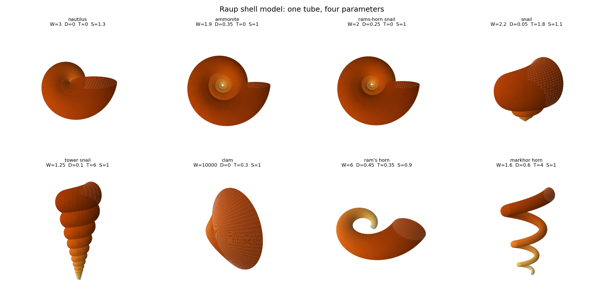

# shell-coiling-genes

Shells and horns that coil (snails, clams, nautilus, ram's horns) differ geometrically by a
few parameters of the growing tube (Raup 1966): **W** (how fast it widens per turn),
**D** (distance from the coiling axis), **T** (translation along the axis) and **S** (shape of
the opening). This project asks which parts of the genome go with those parameters, using
public data only.

**Results page:** [docs/index.html](docs/index.html), served by GitHub Pages.
**Full write-up:** [analysis/results/FINDINGS.md](analysis/results/FINDINGS.md)

## Findings so far (rough periwinkle, *Littorina saxatilis*)
- Coil expansion **W** maps to chromosome LG17 (64-70 Mb, significant). **D** maps to the same area (at threshold).
- Opening shape **S** and shell size map to a 17 Mb inversion on LG6 (just below threshold).
- The LG6 inversion holds the periwinkle version of *Lsdia1*, the formin gene that sets coiling direction in the pond snail *Lymnaea* (66-69% protein identity).
- Several LG6 genes are strongly mantle-specific (the shell-building tissue). A dispatched-gene cluster in the W region is not.
- Gene trees: periwinkle has a single diaphanous gene (the LG6 one). Six of its LG17 dispatched genes belong to a mollusc-only lineage that is present in 12 of 14 shelled species and absent from all 5 shell-less or internal-shell species examined.
- These are candidate regions and genes, not demonstrated causes.

## Scripts
| Script | What it does |
|---|---|
| `raup.py` | Draws Raup shells from W, D, T, S (`python raup.py --list`) |
| `measure.py` | Measures W, D, T, S from a photo by clicking landmarks (`--selftest` to check) |
| `analysis/littorina_qtl.py` | QTL scan of the Koch et al. 2021 F2 cross for Raup-type traits |
| `analysis/map_qtl_genes.py` | Places markers on the 2024 genome and lists genes in each QTL region |
| `analysis/mantle_expression.py` | Ranks genes by mantle-specific expression (NCBI tissue TPMs) |
| `analysis/gene_family_counts.py` | Counts candidate gene families in 20 molluscs |
| `analysis/gene_trees.py`, `run_trees.sh` | Gene trees for formins and dispatched (MAFFT, trimAl, IQ-TREE) |
| `analysis/dev_expression.py` | Candidate genes across larvae and adult tissues in oyster and Ruditapes (NCBI TPMs) |
| `analysis/dev_timecourse.py` | Candidate genes through development in mussel (PRJNA996031) and apple snail (GSE240084) |
| `site/build.py` | Rebuilds `docs/index.html` from the results |

Python 3.11 with numpy, pandas, matplotlib, biopython. Gene trees use MAFFT, trimAl and IQ-TREE
(installed with micromamba in WSL; see `analysis/run_trees.sh`).

## Data (not in the repository; download to `data/`)
| Folder | Source |
|---|---|
| `data/littorina_koch2021/` | Koch et al. 2021, Dryad [doi:10.5061/dryad.zgmsbccb4](https://datadryad.org/dataset/doi:10.5061/dryad.zgmsbccb4) |
| `data/littorina_v1/` | Westram et al. 2018 assembly, [Zenodo 5003441](https://zenodo.org/records/5003441) |
| `data/littorina_v2/` | NCBI RefSeq [GCF_037325665.1](https://ftp.ncbi.nlm.nih.gov/genomes/all/GCF/037/325/665/GCF_037325665.1_US_GU_Lsax_2.0/): chromosomes NC_090250.1 (LG6) and NC_090261.1 (LG17), `genomic.gff`, `protein.faa`, and `expression/` (RS_2024_12 expression tables and RNA-seq run list) |
| `data/gene_trees/` | Written by `analysis/gene_trees.py fetch` (NCBI) |

## References
- Raup 1966, J. Paleontology 40:1178-1190.
- Koch et al. 2021, Evolution Letters 5:196-213. [PMC8190449](https://pmc.ncbi.nlm.nih.gov/articles/PMC8190449)
- Larsson et al. 2020, J. R. Soc. Interface 17:20190721.
- De Jode et al. 2024, chromosome-level *Littorina saxatilis* genome. [PMC11050657](https://pmc.ncbi.nlm.nih.gov/articles/PMC11050657/)
- Davison et al. 2016, Current Biology 26:654-660 (Lsdia1 and coiling direction).

## License
Code: MIT. Text, figures and results page: CC BY 4.0. See [LICENSE](LICENSE).
